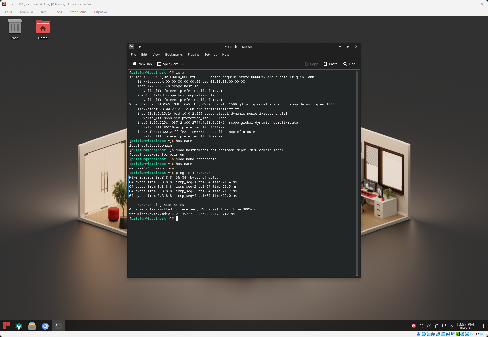

## Установка дистрибутива

### Задача

#### 1.1 Настройка сети

Выберите динамическую настройку IP-адреса сетевого интерфейса (зависит от установки, например, `eth0`) по протоколу DHCP.

#### 1.2 Настройка имени хоста

Установите имя хоста `mephi-2026.domain.local`.

#### 1.3 Проверка сетевой связности

Проверьте связь с внешним миром - выполните `ping` до `8.8.8.8`.

### Решение

```bash
# Проверка настройки сетевого интерфейса'
# В данном случае 2 сетевых интерфейса lo и enp0s3 (сетевой интерфейс VirtualBox)
# Он уже настроен на динамическое получение настроек сети (DHCP), `dynamic` в выводе
ip a

# Проверка имени хоста
hostname

# Изменение имени хоста
sudo hostnamectl set-hostname mephi-2026.domain.local

# Изменение файла резолюции доменных имен
sudo nano /etc/hosts

# Проверка изменений имени хоста
hostname

# Проверка доступа к интернету
ping -c 4 8.8.8.8 
```

### Скриншот




