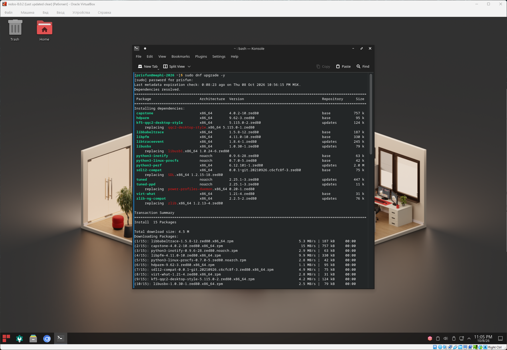
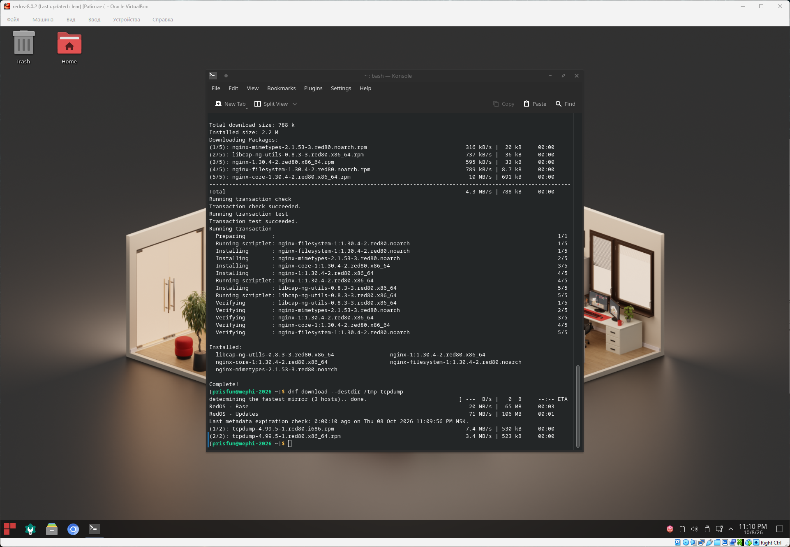
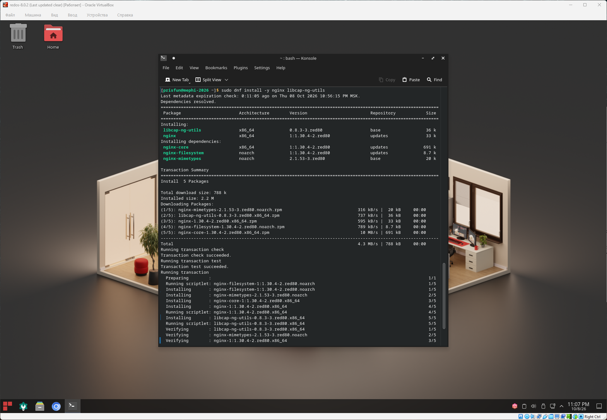
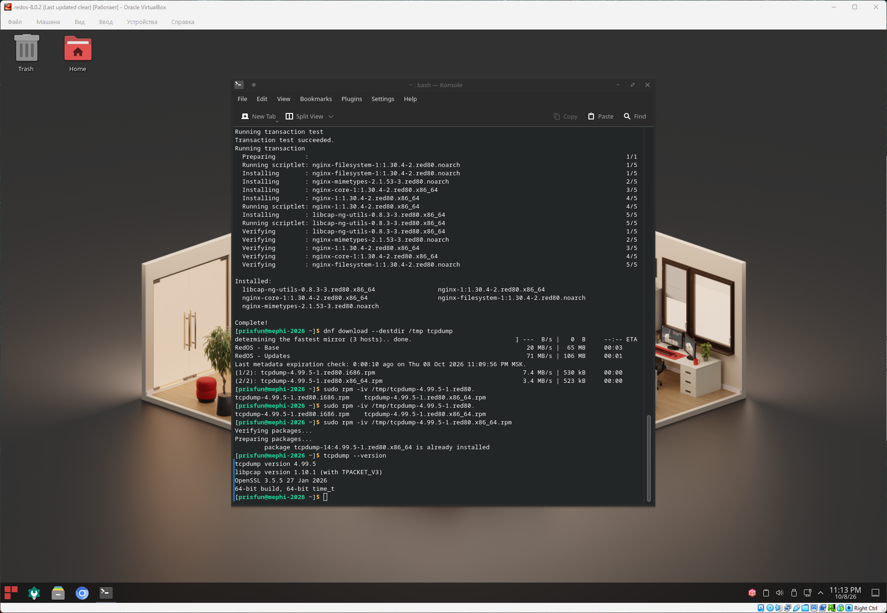

## Управление программным обеспечением

### Задача

#### 2.1. Обновление дистрибутива

Выполните обновление пакетов дистрибутива.

#### 2.2. Установка пакетов из репозиториев

Установите следующие пакеты с помощью команды `dnf`:

- Веб-сервер `nginx`
- Утилиту для работы с привилегиями (capabilities) `libcap-ng-utils`

#### 2.3. Установка локального RPM-пакета

Скачайте пакет tcpdump (бинарный RPM-пакет) в директорию `/tmp` с помощью менеджера пакетов `dnf download`.\
Установите его в систему с помощью команды `rpm`.

### Решение

```bash
# Обновление пакетов дистрибутива
sudo dnf upgrade -y

# Установка пакетов nginx libcap-ng-utils
sudo dnf install -y nginx libcap-ng-utils

# Установка rpm пакет tcpdump в директорию /tmp
dnf download --destdir /tmp tcpdump

# Установка пакета tcpdump для x86_64
sudo rpm -iv /tmp/tcpdump-4.99.5-1.red80.x86_64.rpm

# Проверка установки
tcpdump --version
```

### Скриншот









