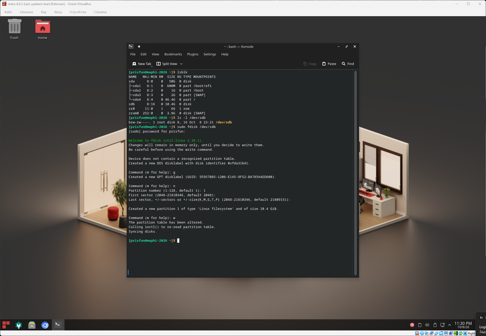
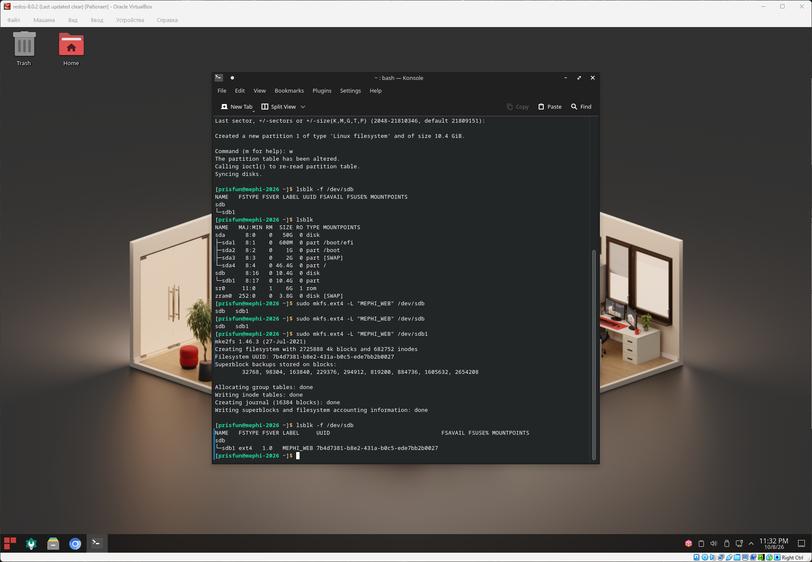
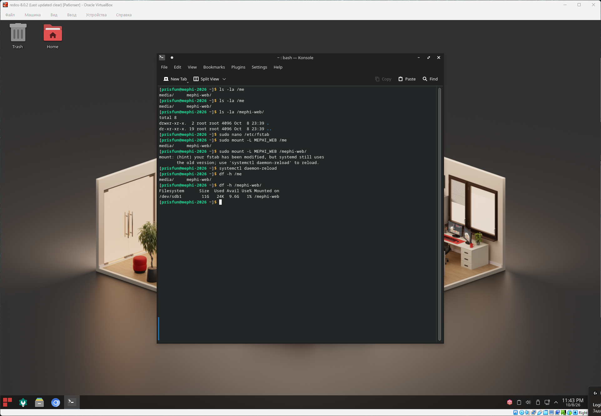

## Управление файловыми системами

### Задача

#### 3.1. Создание файловой системы

- Подключите второй диск (например, /dev/sdb).
- На втором диске создайте один раздел для хранения данных проекта, занимающий всё пространство диска. 
- Отформатируйте раздел как файловую систему ext4 с меткой тома `MEPHI_WEB`.

#### 3.2. Монтирование файловой системы

- Создайте точку монтирования /mephi-web.
- Настройте автоматическое монтирование созданного раздела при начальной загрузке, используя метку тома в качестве идентификатора файловой системы.
- Выполните ручное монтирование раздела.

#### Решение

В настройках VirtualBox добавим блочное устройство в виде виртуального жесткого диска с размеров 10ГБ.

```bash
# Вывод списка доступных блочных устройств
# Добавленный диск имеет название /dev/sdb
lsblk 

# Вывод свойств
# Тип b - блочное устройство
ls -l /dev/sdb 

# Разметка диска в интерактивном режиме
# g - создать таблицу разделов GPT
# n - указать количество разделов, в нашем случае 1
# w - записать изменения
sudo fdisk /dev/sdb 

# Проверка создания раздела sdb1
lsblk -f /dev/sdb

# Создание файловой системы ext4 с меткой MEPHI_WEB на разделе /dev/sdb1
sudo mkfs.ext4 -L "MEPHI_WEB" /dev/sdb1

# Проверка создания файловой системы
lsblk -f /dev/sdb

# Создание директории /mephi-web
sudo mkdir /mephi-web

# Проверка создания директории
ls -la

# Настройки автоматического монтирования созданного раздела при начальной загрузке
# LABEL=MEPHI_WEB  /mephi-web  ext4  defaults  1  2
sudo nano /etc/fstab 

# Ручное монтирование раздела в директорию /mephi-web
sudo mount -L MEPHI_WEB /mephi-web/

# Выполняем рекомендации по обновлению сервисов, после изменения файла системных таблиц
systemctl daemon-reload

# Проверка ручного монтирования раздела в директорию /mephi-web 
df -h /mephi-web/
```

### Скриншот





