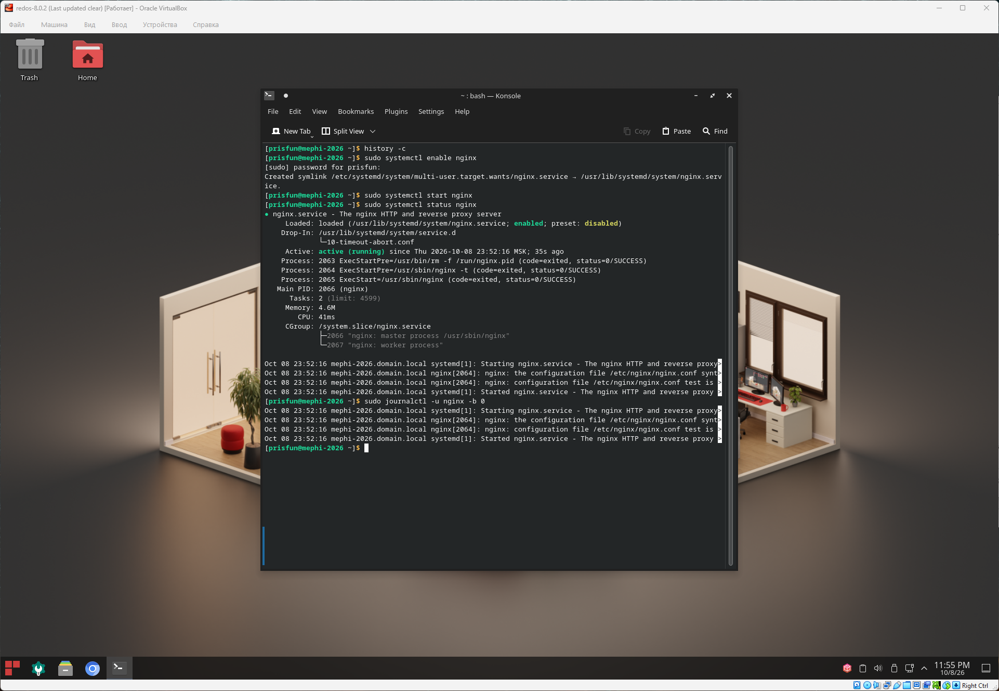

## Управление сервисами

### Задача

#### 4.1. Управление веб-сервером

- Запустите веб-сервер `nginx`.
- Веб-сервер `nginx` должен автоматически запускаться при начальной загрузке.

#### 4.2. Журналирование

С помощью `journalctl` найдите все сообщения журнала, относящиеся к сервису `nginx`, для текущей загрузки системы.

### Решение

```bash
# Добавление сервиса nginx для запуска при начальной загрузке
sudo systemctl enable nginx

# Запуск сервиса nginx
sudo systemctl start nginx

# Проверка статуса nginx
# Active: active (running) - сейчас запущен
# Loaded: loaded (...; enabled; ...) - включен для начальной загрузки
sudo systemctl status nginx

# Вывод всех сообщений журнала
# -u nginx // для сервиса nginx
# -b 0     // для текущей загрузки системы
sudo journalctl -u nginx -b 0
```

### Скриншот

