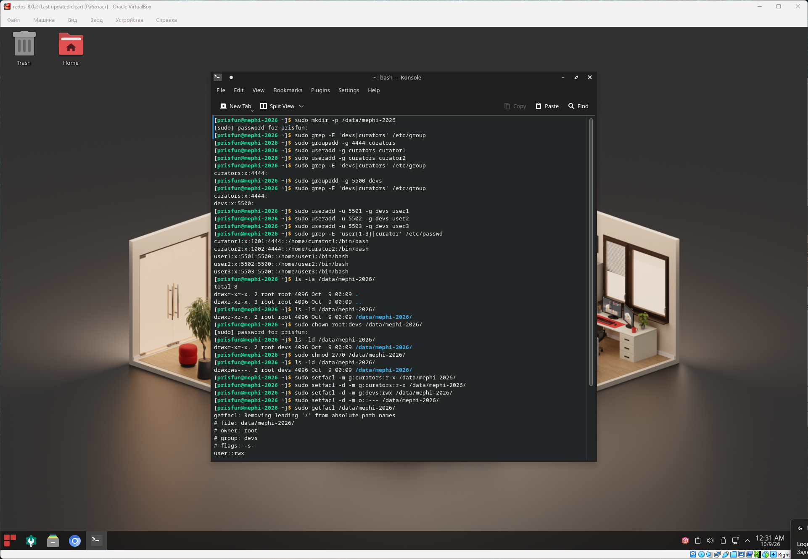
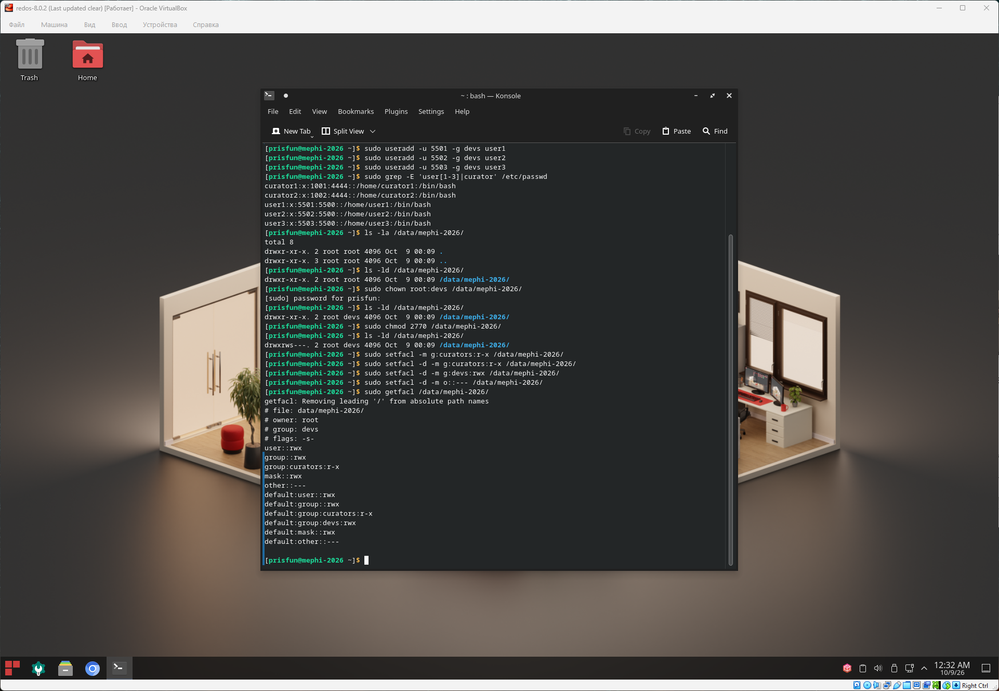
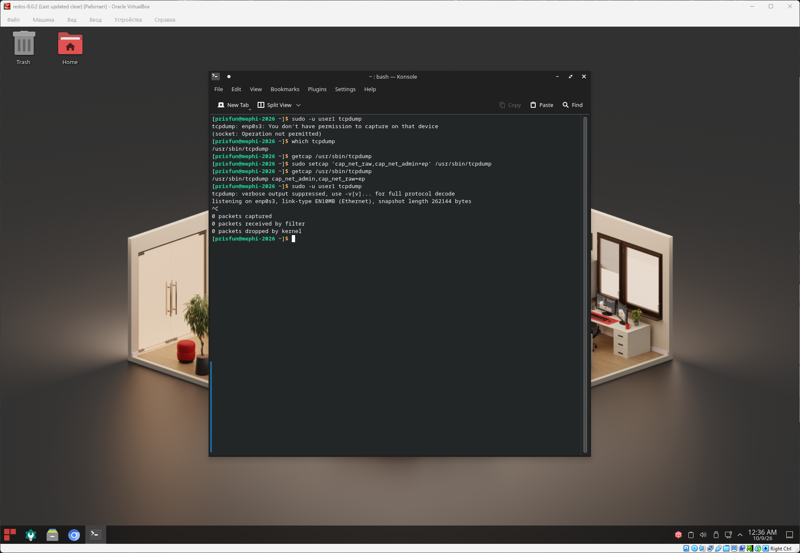
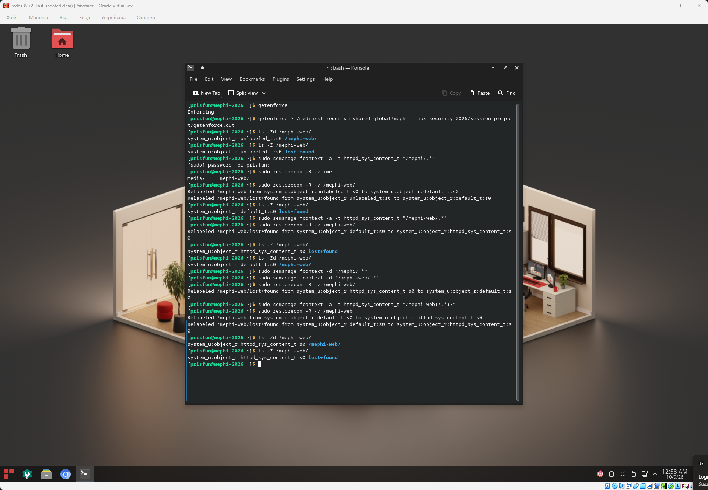

## Управление доступом

### Задача

#### 5.1. Дискреционное управление доступом

- Для хранения файлов проекта создайте директорию `/data/mephi-2026`.
- В команде проекта должны работать три разработчика с именами `user1`, `user2` и `user3` с идентификаторами равными `5501`, `5502` и `5503` соответственно.
- У каждого участника команды должны быть права на чтение и запись на все файлы в директории проекта, т.е. на ВСЕ файлы, которые будут создаваться ЛЮБЫМ из участников команды.
- Также у проекта должны быть два куратора с именами `curator1` и `curator2`, входящими в группу curators с идентификатором группы равным `4444`.
- Для кураторов все файлы, которые есть или будут создаваться в директории проекта участниками команды, должны быть доступны на чтение, но не доступны для модификации.
- Для всех остальных пользователей все файлы в директории проекта должны быть полностью недоступны.

#### 5.2. Привилегии (уменьшение количества set-UID-программ)

- Утилита tcpdump для своего запуска требует права root и поэтому является set-UID-программой. Настройте исполняемый файл tcpdump таким образом, чтобы его мог запустить обычный пользователь.
- Проверьте, что обычный пользователь `user1` может успешно выполнить команду tcpdump.

#### 5.3. Мандатное управление доступом (MAC)

- Убедитесь, что SELinux работает в режиме "Enforcing" (включен).
- Веб-сервер nginx должен отдавать файлы из нестандартной директории `/mephi-web`.

### Решение

#### 5.1. Дискреционное управление доступом

Для разграничения доступа, будем использовать базовые права + ACL.
Необходимо это для того, потому что у одного файла в системе может быть строго один владелец или группы владельцев.
Базовая группа владельцев будет `devs` для совместной работы, для всех остальных доступ будет разграничен с помощью списка контроля доступа (ACL)

```bash
# Создание директории /data/mephi-2026
sudo mkdir -p /data/mephi-2026

# Проверка что группы devs, curators не существуют
sudo grep -E 'devs|curators' /etc/group

# Создание группы curators c идентификатором группы 4444
sudo groupadd -g 4444 curators

# Создание пользователя curator1 с основной группой curators
sudo useradd -g curators curator1

# Создание пользователя curator1 с основной группой curators
sudo useradd -g curators curator2

# Проверка что группа curators существует
sudo grep -E 'devs|curators' /etc/group

# Создание группы curators c идентификатором группы 5500
sudo groupadd -g 5500 devs

# Проверка что группа devs существует
sudo grep -E 'devs|curators' /etc/group

# Создание пользователя user1 с основной группой devs и идентификатором 5501
sudo useradd -u 5501 -g devs user1

# Создание пользователя user2 с основной группой devs и идентификатором 5502
sudo useradd -u 5502 -g devs user2

# Создание пользователя user3 с основной группой devs и идентификатором 5503
sudo useradd -u 5503 -g devs user3

# Проверка создание пользователей
sudo grep -E 'user[1-3]|curator' /etc/passwd

# Вывод свойств содержимого директории /data/mephi-2026/
ls -la /data/mephi-2026/

# Вывод свойств директории /data/mephi-2026/
ls -ld /data/mephi-2026/

# Установка группы владельца devs для директории /data/mephi-2026
sudo chown root:devs /data/mephi-2026/

# Проверка прав для директории /data/mephi-2026
ls -ld /data/mephi-2026/

# Установка прав для директории /data/mephi-2026
# 2 - установка флага SGID       // для наследования группы владельца devs
# 7 - rwx владельцу директории
# 7 - rwx группе директории
# 0 - без прав для others  
sudo chmod 2770 /data/mephi-2026/

# Проверка прав для директории /data/mephi-2026
ls -ld /data/mephi-2026/

# Добавление ACL
# Установка ACL для группы curators (для текущих папок и директорий) чтение, поиск и исполнение
sudo setfacl -m g:curators:r-x /data/mephi-2026/

# Установка ACL для группы curators (для новых папок и директорий при создании)
sudo setfacl -d -m g:curators:r-x /data/mephi-2026/

# Установка ACL для группы devs (для новых папок и директорий при создании)
sudo setfacl -d -m g:devs:rwx /data/mephi-2026/

# Установка ACL для others (для новых папок и директорий при создании)
sudo setfacl -d -m o::--- /data/mephi-2026/

# Проверка установленных ACL для директории /data/mephi-2026
sudo getfacl /data/mephi-2026/
```

#### Скриншот






#### 5.2. Привилегии (уменьшение количества set-UID-программ)

```bash
# Исполнение команды tcpdump от пользователя user1
# Нет прав
sudo -u user1 tcpdump 

# Поиск пути исполняемого файла
which tcpdump 

# Проверка списка привилегий для tcpdump
# Привилегии отсутствуют
getcap /usr/sbin/tcpdump 

# Добавляем привилегии effective + permitted, для запуска без прав суперпользователя
sudo setcap 'cap_net_raw,cap_net_admin+ep' /usr/sbin/tcpdump 

# Проверка списка привилегий для tcpdump
getcap /usr/sbin/tcpdump 

# Исполнение команды tcpdump от пользователя user1
# Успех
sudo -u user1 tcpdump 
```

#### Скриншот



#### 5.3. Мандатное управление доступом (MAC)

```bash
# Проверка режима SELinux
# Enforcing
getenforce 

# Проверка контекста SELinux для директории /mephi-web
ls -Zd /mephi-web/

# Проверка контекста SELinux для содержимого директории /mephi-web
ls -Z /mephi-web/

# Так как nginx является сервером, для директории /mephi-web 
# должен быть установлен универсальный SELinux контекст httpd_sys_content_t
# что бы nginx мог читать содержимое директории

# Добавление нового правила для SELinux с нужным контекстом для директории /mephi-web и ее содержимого
sudo semanage fcontext -a -t httpd_sys_content_t "/mephi-web(/.*)?"

# Перезапись меток после добавления правила SELinux
sudo restorecon -R -v /mephi-web

# Проверка контекста SELinux для директории /mephi-web
ls -Zd /mephi-web/

# Проверка контекста SELinux для содержимого директории /mephi-web
ls -Z /mephi-web/

# Нужно не забыть поменять root директорию для nginx на `/mephi-web;`
sudo nano /etc/nginx/nginx.conf

# Перезапуск сервиса nginx
sudo systemctl restart nginx
```

#### Скриншот

