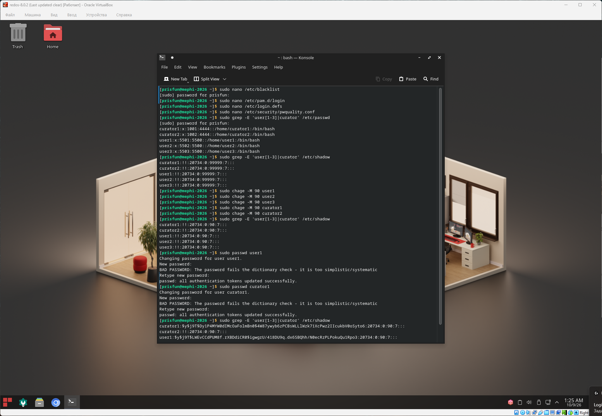

## Аутентификация

### Задача

#### 6.1. Ограничение входа для пользователей

- Кураторы проекта не должны иметь возможности входить в систему локально (через консоль).
- Все остальные пользователи должны иметь возможность входить в систему.

#### 6.2. Управление паролями

- Пользователь должен менять свой пароль каждые 90 дней.
- Минимальная длина пароля пользователя должна быть 12 символов.

### Решение

```bash
# Создаем файл блэклиста для ограничения входа пользователей через консоль (локально)
# Указать имена пользователей для ограничения входа
# curator1
# curator2
sudo nano /etc/blacklist

# Добавление правила аутентификации для PAM
# тип  обязательность     модуль          тип проверки отклонить  файл для проверки   если файл вдруг удален пропустить
# auth       required     pam_listfile.so item=user    sense=deny file=/etc/blacklist onerr=succeed 
sudo nano /etc/pam.d/login 

# Настройки пароля для новых пользователей
# Установка срока действия пароля 90 дней
# PASS_MAX_DAYS	90
sudo nano /etc/login.defs 

# Установка правил пароля
# minlen = 12 - минимальное кол-во символов
sudo nano /etc/security/pwquality.conf

# Проверка настроек для созданных ранее пользователей 
# Учетная запись заблокирована, пароль не установлен
sudo grep -E 'user[1-3]|curator' /etc/shadow

# Обновление срока действия пароля для созданных раннее пользователей
sudo chage -M 90 user1
sudo chage -M 90 user2
sudo chage -M 90 user3
sudo chage -M 90 curator1
sudo chage -M 90 curator2

# Проверка настроек для созданных ранее пользователей 
sudo grep -E 'user[1-3]|curator' /etc/shadow

# Установка пароля для пользователя user1
sudo passwd user1

# Установка пароля для пользователя user1
sudo passwd curator1

# Проверка настроек для созданных ранее пользователей 
sudo grep -E 'user[1-3]|curator' /etc/shadow
```

### Скриншот

