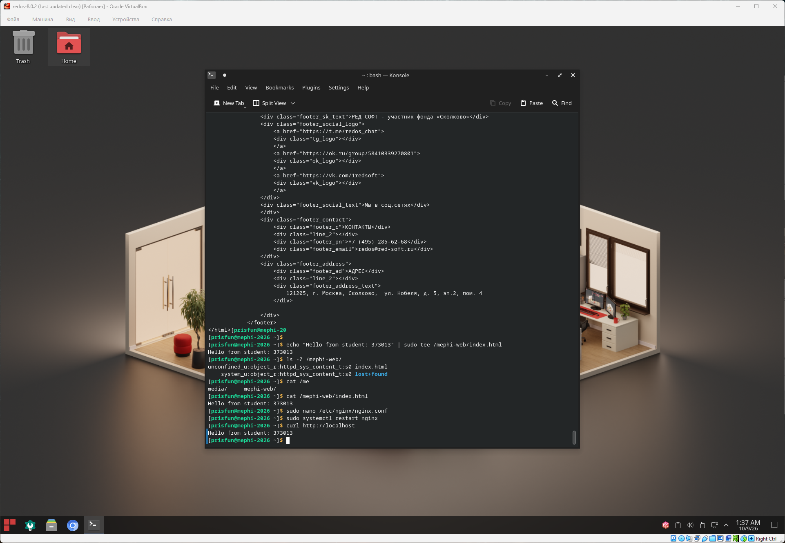

## Тестирование

### Задача

#### 7.1. Создание web-страницы

- Создайте в директории `/mephi-web` файл `index.html` с текстом:

```html
Hello from Student: <ВАШ_НОМЕР>
 ```

#### 7.2. Проверка доступности

- Убедитесь, что web-сервер отображает страницу.

Пример проверки после настройки:

```bash
curl http://localhost/
```

Ожидаемый результат:

```html
Hello from Student: 12345
``` 

### Решение

```bash
# Создание страницы index.html в директории /mephi-web
echo "Hello from student: 373013" | sudo tee /mephi-web/index.html

# Проверка что метки SELinux проставлены для файла index.html
ls -Z /mephi-web/

# Вывод содержимого файла /mephi-web/index.html
cat /mephi-web/index.html 

# Вывод контента со страницы localhost:80 сервера nginx 
curl http://localhost
```

### Скриншот

Note: Директории для поиска контента по-умолчанию nginx, исправлена в конце работы
